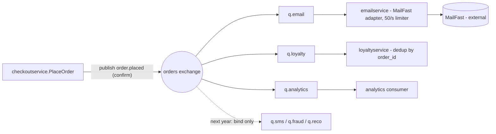

> Drafted with AI assistance (Claude Code, Task 2 run b); reviewed, revised and approved by the author. The AI draft is kept unchanged at `exercise/outputs/2b-adr.md` for comparison.

# ADR-0002: Publish an "order placed" event to RabbitMQ and run post-order actions as independent consumers

- **Status:** Proposed
- **Date:** 2026-10-21
- **Deciders:** Watayut (architect); to be confirmed by the product owner and SRE at the architecture review board

## Context and problem

Requirement **R-12** (`docs/scenario.md`) adds three post-order actions to Online Boutique: send the confirmation email through the external provider **MailFast** (replacing the mock `emailservice` logic), award **loyalty points** via a new `loyaltyservice`, and record an **"order placed" analytics event**. Marketing expects more such actions next year (SMS, fraud scoring, recommendations update).

**How checkout works today** (`system/online-boutique/src/checkoutservice/main.go`, `PlaceOrder`, lines 230–280):

| Step | Call | Evidence | On failure |
|---|---|---|---|
| 1 | Generate `orderID` (UUID) | line 233 | order fails |
| 2 | Get cart, product prices, currency conversion, shipping quote | `prepareOrderItemsAndShippingQuoteFromCart`, lines 238, 288–311 | order fails |
| 3 | Charge card (`paymentservice.Charge`) | lines 252–256, 369–377 | order fails (`codes.Internal`) |
| 4 | Ship order (`shippingservice.ShipOrder`) | lines 258–261, 386–394 | order fails (`codes.Unavailable`) |
| 5 | Empty cart | line 263 (error ignored) | order succeeds |
| 6 | Send confirmation email (`emailservice.SendOrderConfirmation`) | lines 273–277, 379–384 | **warning logged only, order succeeds** |

All downstream calls are **synchronous gRPC** over connections opened at start-up (`mustConnGRPC`, lines 118–123; `EMAIL_SERVICE_ADDR`, line 115). There is **no message broker and no order database** in this file: the order exists only in the `PlaceOrderResponse` returned to the caller (lines 265–279). Not evidenced in the provided files: whether any other component persists orders.

**Facts that constrain the decision** (`docs/scenario.md`, "Quality goals and constraints"):

| Topic | Fact | Why it matters |
|---|---|---|
| Checkout latency | p95 `PlaceOrder` ≤ **500 ms** (today ≈ 300 ms) | leaves ≈ 200 ms of budget for anything new on the request path |
| Peak load | **200 orders/s** at the 11.11 sale | fan-out of 3 actions = 600 downstream calls/s |
| MailFast | p95 **1.5 s**, p99 **8 s**; ≈ **0.5 %** failures; rate limit **50 emails/s** | a synchronous MailFast call alone breaks the 500 ms budget; at peak, 150 orders/s exceed the rate limit and must be buffered somewhere |
| Loyalty | awarded **within 1 minute**, **exactly once** | needs reliable delivery and de-duplication, but not synchronous execution |
| Availability | an order must **never fail** because email, loyalty or analytics is down | the three actions must be decoupled from the success of `PlaceOrder` |
| Team | 4 developers, strong in Go/gRPC, two have used **RabbitMQ** | a broker is feasible; RabbitMQ has the lowest learning cost |
| Operations | Kubernetes; prefers **open-source, self-hosted** over cloud-managed | rules out cloud-only queues as the default |

The problem: **how should `checkoutservice` trigger the post-order actions so that checkout latency and availability are protected, loyalty points are exactly-once, MailFast's rate limit is respected, and new actions can be added without reopening checkout?**

## Decision drivers

1. **Availability of checkout:** failure or slowness of MailFast, `loyaltyservice` or analytics must never fail an order (hard constraint).
2. **Performance:** p95 `PlaceOrder` ≤ 500 ms at 200 orders/s; MailFast's p95 of 1.5 s cannot sit on the request path.
3. **Reliability of loyalty points:** exactly once, within 1 minute, even if `loyaltyservice` restarts or is briefly down.
4. **Throughput smoothing:** 200 orders/s in, 50 emails/s out to MailFast, 0.5 % failures to retry: emails need a durable buffer and retries.
5. **Modifiability / extensibility:** SMS, fraud scoring and recommendations are expected next year; adding an action should not change `checkoutservice`.
6. **Operability and team fit:** 4 Go developers, RabbitMQ experience, open-source self-hosted on Kubernetes, as few new moving parts as possible.
7. **Cost:** modest extra infrastructure; no cloud-only managed services.
8. **Email delivery delay [Assumption]:** a confirmation email delayed up to **15 minutes** during the 11.11 peak is acceptable. This is not stated in the scenario and must be confirmed with the product owner. At 200 orders/s in and 50 emails/s out, every minute of peak needs about 3 minutes to drain, so a 15-minute budget covers a peak of roughly 5 minutes; a longer peak needs a decision from the product owner (see Open questions).

## Considered options

1. **Synchronous gRPC fan-out in `PlaceOrder`** (extend today's pattern): call a MailFast adapter, `loyaltyservice` and an analytics endpoint in sequence, log-and-continue on failure.
2. **In-process asynchronous fan-out**: `PlaceOrder` returns immediately and runs the three actions in background goroutines inside `checkoutservice`, with in-memory retry.
3. **Publish an `OrderPlaced` event to a self-hosted RabbitMQ**; `emailservice` (rewritten as a MailFast adapter), `loyaltyservice` and an analytics consumer each subscribe through their own durable queue.
4. **Publish an `OrderPlaced` event to a self-hosted Kafka topic**, with the same three consumers as consumer groups.

### Pros and cons of the options

| Option | Pros | Cons |
|---|---|---|
| 1. Synchronous gRPC fan-out | Smallest code change (same pattern as lines 273–277); no new infrastructure; easy to trace end to end; team already fluent in gRPC | **Breaks the latency goal:** 300 ms + MailFast p95 1.5 s ≫ 500 ms (performance). No buffering: at 200 orders/s, 150 emails/s exceed MailFast's 50/s limit and are rejected (reliability). A failed loyalty call is only logged, so "exactly once within 1 minute" degrades to "at most once" (reliability). Every new action means another call inside `PlaceOrder` (modifiability). |
| 2. In-process async (goroutines) | Keeps p95 at ≈ 300 ms (performance); no new infrastructure (cost, operability); order never fails because of a downstream (availability) | Work is **lost when a `checkoutservice` pod restarts, crashes or is scaled down** mid-flight, so loyalty points can be silently dropped (reliability). No shared buffer across replicas, so the 50 emails/s limit can only be enforced per replica (throughput). Retries hold memory under peak load. Each new action still changes `checkoutservice` (modifiability). |
| 3. RabbitMQ event | p95 adds only a local publish with publisher confirm, well inside the 200 ms budget (performance). Order succeeds even if every consumer is down; messages wait in durable queues (availability). Durable queue + consumer ack + retry/dead-letter give at-least-once delivery; de-duplication by `order_id` in `loyaltyservice` yields effective exactly-once (reliability). The email queue absorbs the 200/s vs 50/s mismatch and the 0.5 % MailFast failures are retried (throughput). A new action = a new queue bound to the exchange, **no change to `checkoutservice`** (modifiability). Open-source, self-hosted, two developers have used it (operability, team fit). | One more stateful component to run and monitor (operability, cost). Consumers must be idempotent; without an order store there is no transactional outbox, so a publish failure after payment needs explicit handling (reliability). Publishing happens after the response path is otherwise done, so a trace now spans sync and async parts (observability). |
| 4. Kafka event | Same decoupling and extensibility benefits as option 3; retained log lets analytics replay history (modifiability); very high throughput headroom (scalability) | Heavier to operate (brokers, controller/ZooKeeper, partitions, consumer-group rebalances) for 4 developers with no stated Kafka experience (operability, team fit). 200 orders/s does not need Kafka's throughput (cost). Per-message retry/dead-lettering and rate-limited consumption are less natural than in RabbitMQ (reliability). |

A managed cloud queue (e.g. a cloud pub/sub service) was not considered further because the company prefers open-source, self-hosted components (`docs/scenario.md`, Operations).

## Decision

Choose **option 3: publish an `OrderPlaced` event to a self-hosted RabbitMQ cluster and run every post-order action as an independent consumer.**

Concretely:

- **Producer.** In `checkoutservice.PlaceOrder`, replace the synchronous `sendOrderConfirmation` call (lines 273–277) with `publishOrderPlaced(ctx, event)`, executed after payment, shipping and cart-emptying, with the same "log a warning, never fail the order" semantics. The event carries `order_id` (the UUID from line 233), `user_id` and `email` (from `PlaceOrderRequest`, lines 231, 273), the `OrderResult` fields (lines 265–271), the order `total` (computed at lines 243–250 but not in `OrderResult`), the payment `transaction_id` (line 252) and a timestamp. Publish to a durable **topic exchange `orders`** with routing key `order.placed`, `persistent` delivery mode and **publisher confirms**, with a short deadline so the publish stays within the 200 ms latency headroom.
- **Consumers, one durable queue each**, bound to `order.placed`:
  - `emailservice` is **rewritten as a MailFast adapter**: it consumes `q.email`, renders the confirmation and calls MailFast with a **token-bucket limiter at ≤ 50 emails/s cluster-wide** and bounded retries (0.5 % failures, p99 8 s), then acks. The gRPC `SendOrderConfirmation` RPC is no longer called by checkout.
  - the new `loyaltyservice` (Go, matching team skills) consumes `q.loyalty`, awards points and **de-duplicates by `order_id`** before acking, so redeliveries never double-award.
  - an `analytics` consumer on `q.analytics` writes the "order placed" event to the marketing team's destination (format and destination: see Open questions).
- **Delivery semantics:** manual acks after the side effect; message TTL + **dead-letter queues** per consumer for poison messages; prefetch limits sized per consumer.
- **Extensibility rule:** a future SMS, fraud-scoring or recommendations action adds a new queue bound to `order.placed`; `checkoutservice` and the event schema are not touched (schema changes are additive only).
- **Infrastructure:** RabbitMQ deployed in-cluster (open source, self-hosted) with quorum queues over 3 replicas in production, as `docs/adr/0001` does for Redis with replication. **[Assumption]** No broker exists in the cluster today (none is evidenced in the manifests), so RabbitMQ is new infrastructure owned by the team.
- **Publish failure after payment (decided):** the order still succeeds. The publish is retried within the remaining latency budget; on final failure the full event is logged at error level and an alert fires, and the event is re-published by hand from the log using a small CLI. With a 3-node quorum-queue cluster this case is expected to be rare. A transactional outbox is **explicitly out of scope** for this ADR because Online Boutique has no order store to host it; if an order store is introduced later, a follow-up ADR should add the outbox and retire manual replay.
- **Personal data in the event (decided):** the event carries the customer's email and shipping address because consumers have no order store to fetch them from. It never carries card data; only the payment `transaction_id`. Mitigations: TLS between all services and RabbitMQ, encrypted persistent volumes for the broker, a message TTL so processed messages do not linger, and no logging of the event body except on the publish-failure path above. Data residency rules are not evidenced (see Open questions).

Why this option wins: it is the only one that satisfies the three hard constraints at once (p95 ≤ 500 ms, order never fails, loyalty exactly-once within 1 minute) *and* the throughput mismatch with MailFast, while matching the team's RabbitMQ experience and the self-hosted preference. Kafka would satisfy the same constraints at a higher operating cost that 200 orders/s does not justify.

## Consequences

- **Positive:** `PlaceOrder` no longer waits on MailFast; the request path gains only a local publish, so p95 stays near today's ≈ 300 ms, well under 500 ms (performance).
- **Positive:** email, loyalty and analytics outages no longer affect order success; messages queue until consumers recover (availability).
- **Positive:** durable queues + acks + `order_id` de-duplication give effectively exactly-once loyalty awards, and a consumer with no rate limit can process 200 events/s well within the 1-minute goal (reliability).
- **Positive:** the email queue absorbs 200 orders/s against MailFast's 50 emails/s and retries the 0.5 % failures (throughput, reliability).
- **Positive:** new post-order actions bind a new queue; `checkoutservice` is closed for modification (modifiability).
- **Positive:** open-source, self-hosted, Go consumers with gRPC still used for the synchronous calls (team fit, cost, portability).
- **Negative:** RabbitMQ is a new stateful component to deploy, back up, upgrade and monitor; queue depth, consumer lag and dead-letter counts become new operational signals (operability, cost).
- **Negative:** email is now eventually delivered. At 200 orders/s with a 50/s limit, the email backlog grows by 150 messages/s during the peak and drains at 50/s afterwards (about 3 minutes of drain per 1 minute of peak). Accepted under driver 8 (up to 15 minutes), to be confirmed by the product owner (user experience).
- **Negative:** eventual consistency: the customer sees "order placed" before points appear; analytics data is near-real-time, not synchronous (consistency).
- **Negative:** the mock `emailservice` is rewritten and its gRPC contract with checkout is dropped; `checkoutservice` gains an AMQP dependency alongside gRPC (modifiability of the current code, learning cost).
- **Negative:** the event carries the customer's email address and shipping address through the broker, which widens the footprint of personal data; mitigated by the TLS, encryption-at-rest and TTL rules in the Decision (security/privacy).
- **Risks and mitigations:**
  - *Publish fails after payment and shipping succeeded* (broker unreachable). The order must still succeed, so the event would be lost. Handled as decided above: brief retry, error-level log of the full event, alert, manual re-publish; 3-node quorum-queue cluster to keep this rare. Residual risk: a human step is needed to award points and send the email for those orders, and the 1-minute loyalty goal is missed for them. Accepted until an order store exists.
  - *Duplicate deliveries* (consumer crash after side effect, before ack). Mitigation: all consumers idempotent; `loyaltyservice` keeps a processed-`order_id` set in its own store; `emailservice` may use `order_id` as MailFast's idempotency key if MailFast supports one (not evidenced).
  - *Poison messages block a queue.* Mitigation: bounded retries then dead-letter queue, with an alert and a runbook.
  - *Single `emailservice` replica exceeds 50/s or multiple replicas sum to more than 50/s.* Mitigation: enforce the limiter per replica with the per-replica share of 50/s, or set the queue's consumer prefetch so total throughput cannot exceed the limit; verify in the load test.
  - *RabbitMQ becomes a single point of failure for post-order actions.* Mitigation: clustered quorum queues; checkout itself keeps working even if the broker is down (orders succeed, events are logged).
  - *Schema drift as more consumers appear.* Mitigation: version the event (`order.placed.v1`), additive changes only, one shared Go package for the event type.

## Validation

- **Latency:** load test `PlaceOrder` at 200 orders/s (e.g. with the Locust `loadgenerator`, as in ADR-0001) with the broker running; p95 must stay ≤ 500 ms and within ≈ 10 % of the current ≈ 300 ms baseline.
- **Availability:** chaos tests during the same load: stop `emailservice`, `loyaltyservice`, the analytics consumer, a MailFast stub, and finally one RabbitMQ node; order success rate must stay at 100 % attributable to those components.
- **Loyalty exactly-once within 1 minute:** compare `OrderPlaced` timestamps with point-award timestamps; p100 ≤ 60 s under peak load. Inject forced redeliveries (kill the consumer before ack) and verify zero duplicate awards for the same `order_id`.
- **MailFast rate limit and retries:** against a MailFast stub that enforces 50/s and fails 0.5 % of calls, verify no more than 50 requests/s reach it, every order eventually produces exactly one accepted email, and the dead-letter queue stays empty.
- **Extensibility:** dry-run adding a fourth consumer (e.g. a logging "SMS" stub) by binding a queue only; no change to `checkoutservice` is allowed.
- **Operability:** dashboards and alerts for queue depth, consumer lag, dead-letter counts and publish-confirm failures exist before go-live; review this ADR after the first 11.11 sale.

## Open questions

Not evidenced in the provided files and not decidable by the architect alone. To be raised at the architecture review board:

1. **Order persistence (SRE / team):** does any component store orders? `checkoutservice/main.go` only returns the order in the gRPC response. If an order store exists or is planned, the manual-replay decision should be replaced by a transactional outbox in a follow-up ADR.
2. **Analytics destination and format (product owner / marketing):** where does the marketing team want the "order placed" event (a warehouse, a tracking API, a file)? Which fields and schema?
3. **Loyalty rules and storage (product owner):** how are points computed (per currency unit of `total`, per item?) and where does `loyaltyservice` store balances and processed `order_id`s?
4. **MailFast interface (vendor):** protocol (HTTPS API, SDK), authentication, whether it offers an idempotency key, and whether the 50 emails/s limit is per account or per API key.
5. **Peak duration and email delay (product owner):** how long does the 200 orders/s peak last? Confirms or rejects the 15-minute assumption in driver 8.
6. **Data residency (SRE / compliance):** are there residency or retention rules for customer email and address beyond the encryption and TTL measures decided above?

Decided by the architect in this revision and removed from the open list: deciders, acceptable email delay (driver 8), existence of a broker (assumed none), and handling of a failed publish (manual replay, outbox out of scope).
