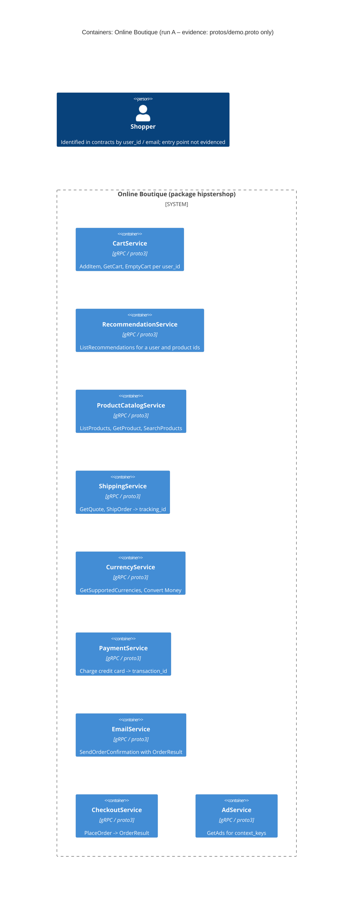

# 1A – Recovered architecture (run A)

## 1. Agent

Claude Code (Anthropic CLI), model `claude-fable-5-1` (Fable 5.1).

## 2. Files read

- `system/online-boutique/protos/demo.proto` (the only evidence allowed for this run)

## 3. Containers table

The proto file declares nine gRPC service *interfaces* in package `hipstershop`. An interface declaration is evidence that a service with that contract exists; it does not reveal the implementation language, data stores, or deployment units. "Technology" below is therefore limited to what the file shows.

| # | Container | Technology / language | Responsibility (from the RPCs and messages) | Evidence |
|---|-----------|----------------------|----------------------------------------------|----------|
| 1 | `CartService` | gRPC / proto3 interface; implementation language not evidenced | Per-user shopping cart: `AddItem`, `GetCart`, `EmptyCart` keyed by `user_id` | `system/online-boutique/protos/demo.proto` (`service CartService`, lines 23–27) |
| 2 | `RecommendationService` | gRPC / proto3 interface; implementation language not evidenced | Returns recommended `product_ids` for a user and a list of product ids: `ListRecommendations` | `demo.proto` (`service RecommendationService`, lines 56–58) |
| 3 | `ProductCatalogService` | gRPC / proto3 interface; implementation language not evidenced | Product catalogue: `ListProducts`, `GetProduct`, `SearchProducts`; `Product` has id, name, description, picture, `price_usd`, categories | `demo.proto` (`service ProductCatalogService`, lines 71–75; `message Product`, lines 77–87) |
| 4 | `ShippingService` | gRPC / proto3 interface; implementation language not evidenced | Shipping cost quote (`GetQuote`) and shipment creation returning a `tracking_id` (`ShipOrder`) | `demo.proto` (`service ShippingService`, lines 107–110) |
| 5 | `CurrencyService` | gRPC / proto3 interface; implementation language not evidenced | Lists supported ISO 4217 currency codes (`GetSupportedCurrencies`) and converts `Money` (`Convert`) | `demo.proto` (`service CurrencyService`, lines 140–143; `message Money`, lines 146–161) |
| 6 | `PaymentService` | gRPC / proto3 interface; implementation language not evidenced | Charges a credit card for an amount, returning a `transaction_id` (`Charge`) | `demo.proto` (`service PaymentService`, lines 177–179; `message CreditCardInfo`, lines 181–186) |
| 7 | `EmailService` | gRPC / proto3 interface; implementation language not evidenced | Sends an order-confirmation e-mail given an address and an `OrderResult` (`SendOrderConfirmation`) | `demo.proto` (`service EmailService`, lines 199–201) |
| 8 | `CheckoutService` | gRPC / proto3 interface; implementation language not evidenced | Places an order (`PlaceOrder`) from `user_id`, `user_currency`, `Address`, `email`, `CreditCardInfo`; returns an `OrderResult` | `demo.proto` (`service CheckoutService`, lines 224–226; `PlaceOrderRequest`, lines 228–235) |
| 9 | `AdService` | gRPC / proto3 interface; implementation language not evidenced | Returns contextual ads (`redirect_url`, `text`) for a list of `context_keys` (`GetAds`) | `demo.proto` (`service AdService`, lines 243–245) |

Notes on technology evidence:

- The protocol family is gRPC: proto3 `service` / `rpc` blocks are gRPC service definitions (`demo.proto`, line 15 `syntax = "proto3"`).
- `option go_package = "github.com/GoogleCloudPlatform/microservices-demo/hipstershop"` (line 19) only tells us that Go stubs are generated from this file. It does **not** show which services are written in Go. Implementation languages are *Not evidenced in the provided files*.
- **No data stores** (`ContainerDb`) and **no message brokers** (`ContainerQueue`) are evidenced. A proto file cannot show them.
- **No frontend / web container** is evidenced. There is no service in the file that serves HTTP or a UI.

## 4. Dependencies table

A `.proto` file defines *who can be called* (server contracts), not *who calls whom*. It contains no client code, no addresses, no environment variables. Therefore:

| Caller → Callee | Protocol | Evidence |
|-----------------|----------|----------|
| — | — | **No runtime dependency is evidenced in the provided file.** |

What the file *does* show that hints at (but does not prove) dependencies is listed under **Gaps** as `[Inferred]`, per the task rule "If you think one exists but can't prove it, list it under Gaps, not in the diagram."

## 5. Mermaid diagram

The diagram contains exactly the nine evidenced containers. There are no `Rel` lines because no dependency is evidenced, no `ContainerDb`/`ContainerQueue` because none is evidenced, and no `System_Ext` because no external system is evidenced. A `Person` is included because the contracts carry end-user data (`user_id`, `email`, `CreditCardInfo`), but the entry-point container that the user would talk to is not in the evidence, so the person has no `Rel` either.

## 6. Gaps

### 6.1 Dependencies the message shapes suggest, but the file cannot prove — all `[Inferred]`

| Suspected dependency | Why the proto hints at it | What would settle it |
|----------------------|---------------------------|----------------------|
| `CheckoutService` → `CartService` | `PlaceOrderRequest` has only `user_id` (line 229), yet `PlaceOrderResponse.OrderResult.items` (lines 208–214) is a list of `OrderItem{CartItem, Money}`; the items must come from somewhere keyed by `user_id`, and `GetCart(user_id)` returns exactly `CartItem`s. | `system/online-boutique/src/checkoutservice/main.go` (gRPC client set-up) or `kubernetes-manifests/checkoutservice.yaml` (`CART_SERVICE_ADDR`) |
| `CheckoutService` → `ProductCatalogService` | `OrderItem.cost` is `Money` per item, but `CartItem` carries only `product_id`/`quantity`; the price would have to be looked up via `GetProduct`. | same as above (`PRODUCT_CATALOG_SERVICE_ADDR`) |
| `CheckoutService` → `CurrencyService` | `PlaceOrderRequest.user_currency` (line 230) vs. `Product.price_usd` (line 82) implies a conversion. | same as above (`CURRENCY_SERVICE_ADDR`) |
| `CheckoutService` → `ShippingService` | `OrderResult.shipping_tracking_id` and `shipping_cost` (lines 210–211) match `ShipOrderResponse.tracking_id` and `GetQuoteResponse.cost_usd`. | same as above (`SHIPPING_SERVICE_ADDR`) |
| `CheckoutService` → `PaymentService` | `PlaceOrderRequest.credit_card` (line 234) is a `CreditCardInfo`, the exact type `ChargeRequest` needs. | same as above (`PAYMENT_SERVICE_ADDR`) |
| `CheckoutService` → `EmailService` | `PlaceOrderRequest.email` (line 233) and `OrderResult` together form `SendOrderConfirmationRequest` (lines 216–219). | same as above (`EMAIL_SERVICE_ADDR`) |
| `RecommendationService` → `ProductCatalogService` | `ListRecommendationsRequest/Response` deal only in `product_ids`; a recommender would need the catalogue to know which ids exist. Pure speculation from the proto. | `src/recommendationservice/recommendation_server.py` or its manifest (`PRODUCT_CATALOG_SERVICE_ADDR`) |
| Some frontend → `Cart`, `ProductCatalog`, `Currency`, `Recommendation`, `Ad`, `Shipping`, `Checkout` | Nothing in the file calls these; a user-facing container is required for `user_id`, `context_keys`, etc. to originate, but no such service is declared here. | `kubernetes-manifests/frontend.yaml` (all `*_SERVICE_ADDR` variables) and `src/frontend/` |

### 6.2 Other things the evidence cannot answer

| Gap | Extra file that would settle it |
|-----|----------------------------------|
| Implementation language of each service (the `go_package` option covers code generation only) | `system/online-boutique/src/<service>/` (e.g. presence of `main.go`, `*.py`, `*.cs`, `*.java`, `package.json`) or each service's `Dockerfile` |
| Whether a **frontend / web UI** container exists and what protocol the shopper uses (HTTP?) | `kubernetes-manifests/frontend.yaml`, `src/frontend/` |
| **Data stores**: in particular whether `CartService` persists carts in Redis/another store, and whether the catalogue is a file or a database | `kubernetes-manifests/redis.yaml`, `kubernetes-manifests/cartservice.yaml` (`REDIS_ADDR`), `src/productcatalogservice/products.json` |
| **Message brokers / asynchronous flows** (none appear in the proto; all RPCs are request-response) | `kubernetes-manifests/` as a whole |
| **External systems** (real payment gateway, real e-mail provider, real shipping carrier, currency-rate source) vs. mocked ones | `src/paymentservice/`, `src/emailservice/`, `src/shippingservice/`, `src/currencyservice/data/currency_conversion.json` |
| **Load generator / test traffic** container | `kubernetes-manifests/loadgenerator.yaml` |
| Service addresses, ports and the deployment topology | `kubernetes-manifests/*.yaml`, `release/kubernetes-manifests.yaml` |
| Whether `Empty` and `Money` are shared across services at runtime or only at compile time (i.e., whether there is a shared library container) | build files per service (`go.mod`, `requirements.txt`, `*.csproj`, `build.gradle`) |
