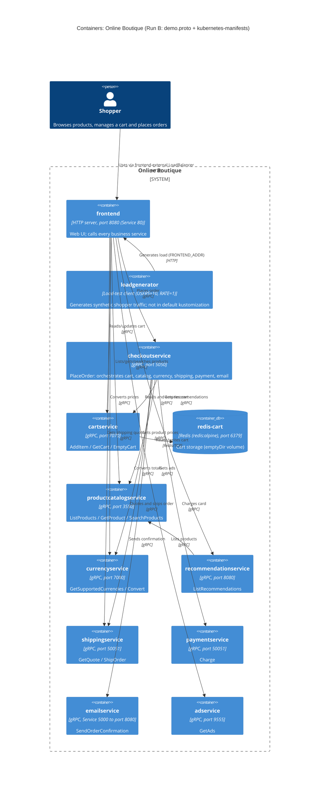

# Task 1, Run B: Recovered architecture of Online Boutique

Evidence allowed for this run: `system/online-boutique/protos/demo.proto` and `system/online-boutique/kubernetes-manifests/`.

## 1. Agent

- Product: Claude Code (Anthropic CLI)
- Model: Claude Fable 5.1 (`claude-fable-5-1`)

## 2. Files read

Task and rules:

- `AGENTS.md` (also pulled in by `CLAUDE.md`)
- `prompts/1-recover-architecture.md`

Evidence:

- `system/online-boutique/protos/demo.proto`
- `system/online-boutique/kubernetes-manifests/README.md`
- `system/online-boutique/kubernetes-manifests/kustomization.yaml`
- `system/online-boutique/kubernetes-manifests/adservice.yaml`
- `system/online-boutique/kubernetes-manifests/cartservice.yaml`
- `system/online-boutique/kubernetes-manifests/checkoutservice.yaml`
- `system/online-boutique/kubernetes-manifests/currencyservice.yaml`
- `system/online-boutique/kubernetes-manifests/emailservice.yaml`
- `system/online-boutique/kubernetes-manifests/frontend.yaml`
- `system/online-boutique/kubernetes-manifests/loadgenerator.yaml`
- `system/online-boutique/kubernetes-manifests/paymentservice.yaml`
- `system/online-boutique/kubernetes-manifests/productcatalogservice.yaml`
- `system/online-boutique/kubernetes-manifests/recommendationservice.yaml`
- `system/online-boutique/kubernetes-manifests/shippingservice.yaml`

No other files were opened.

## 3. Containers table

How the columns were filled:

- **Technology/language.** The manifests reference images by bare name (`image: frontend`, `image: cartservice`, ...; see `README.md`, which says tags are inserted by `skaffold`). They do not reveal the implementation language of any service, so the column records only what the manifests do show: the listening port, the probe type (`grpc:` vs `httpGet:`) and, for the data store, the image. The `option go_package` in `demo.proto` (line 19) only names a Go binding package for the generated stubs; it does not prove any particular service is written in Go.
- **Responsibility.** Taken from the `service` definitions in `demo.proto` where one exists, otherwise from the manifest.

| # | Container | Technology (as evidenced) | Responsibility | Evidence |
|---|-----------|---------------------------|----------------|----------|
| 1 | `frontend` | HTTP server on container port 8080; `httpGet` probes on `/_healthz`; exposed in-cluster as Service `frontend` (port 80) and externally as Service `frontend-external` (`type: LoadBalancer`, port 80). Language: Not evidenced in the provided files. | Web entry point for the shopper. No gRPC service is defined for it in `demo.proto`; its role is shown by the seven `*_SERVICE_ADDR` env vars that point at every other business service. | `kubernetes-manifests/frontend.yaml` (containerPort 8080, `readinessProbe.httpGet`, Service `frontend-external`, env block) |
| 2 | `adservice` | gRPC server on port 9555 (`grpc:` probes, Service port named `grpc`). Language: Not evidenced. | Returns context-targeted ads: `AdService.GetAds(AdRequest) -> AdResponse`. | `protos/demo.proto` (`service AdService`, lines 243-245); `kubernetes-manifests/adservice.yaml` (`PORT=9555`) |
| 3 | `cartservice` | gRPC server on port 7070 (`grpc:` probes, Service port named `grpc`). Language: Not evidenced. | Per-user shopping cart: `CartService.AddItem`, `GetCart`, `EmptyCart`. Persists cart state in `redis-cart` (see dependency D17). | `protos/demo.proto` (`service CartService`, lines 23-27); `kubernetes-manifests/cartservice.yaml` (containerPort 7070, `REDIS_ADDR`) |
| 4 | `redis-cart` (data store) | Redis, image `redis:alpine`, TCP port 6379 (Service port named `tcp-redis`); `tcpSocket` probes; storage is an `emptyDir` volume mounted at `/data`. | Cart storage for `cartservice`. | `kubernetes-manifests/cartservice.yaml` (Deployment `redis-cart`, lines 89-141; Service `redis-cart`, lines 143-156) |
| 5 | `checkoutservice` | gRPC server on port 5050 (`grpc:` probes, Service port named `grpc`). Language: Not evidenced. | Order placement: `CheckoutService.PlaceOrder(PlaceOrderRequest) -> PlaceOrderResponse`. Orchestrates six other services (D10-D15). | `protos/demo.proto` (`service CheckoutService`, lines 224-226); `kubernetes-manifests/checkoutservice.yaml` (`PORT=5050`, env block) |
| 6 | `currencyservice` | gRPC server on port 7000 (`grpc:` probes, Service port named `grpc`). Language: Not evidenced. | Currency list and conversion: `CurrencyService.GetSupportedCurrencies`, `Convert`. | `protos/demo.proto` (`service CurrencyService`, lines 140-143); `kubernetes-manifests/currencyservice.yaml` (`PORT=7000`) |
| 7 | `emailservice` | gRPC server on container port 8080, published as Service port 5000 (`targetPort: 8080`); `grpc:` probes. Language: Not evidenced. | Sends the order confirmation: `EmailService.SendOrderConfirmation(SendOrderConfirmationRequest) -> Empty`. | `protos/demo.proto` (`service EmailService`, lines 199-201); `kubernetes-manifests/emailservice.yaml` (`PORT=8080`; Service `port: 5000`, `targetPort: 8080`) |
| 8 | `paymentservice` | gRPC server on port 50051 (`grpc:` probes, Service port named `grpc`). Language: Not evidenced. | Charges a credit card: `PaymentService.Charge(ChargeRequest) -> ChargeResponse` (returns `transaction_id`). | `protos/demo.proto` (`service PaymentService`, lines 177-179); `kubernetes-manifests/paymentservice.yaml` (`PORT=50051`) |
| 9 | `productcatalogservice` | gRPC server on port 3550 (`grpc:` probes, Service port named `grpc`). Language: Not evidenced. | Product catalogue: `ProductCatalogService.ListProducts`, `GetProduct`, `SearchProducts`. | `protos/demo.proto` (`service ProductCatalogService`, lines 71-75); `kubernetes-manifests/productcatalogservice.yaml` (`PORT=3550`) |
| 10 | `recommendationservice` | gRPC server on port 8080 (`grpc:` probes, Service port named `grpc`). Language: Not evidenced. | Product recommendations: `RecommendationService.ListRecommendations`. Depends on `productcatalogservice` (D16). | `protos/demo.proto` (`service RecommendationService`, lines 56-58); `kubernetes-manifests/recommendationservice.yaml` (`PORT=8080`, `PRODUCT_CATALOG_SERVICE_ADDR`) |
| 11 | `shippingservice` | gRPC server on port 50051 (`grpc:` probes, Service port named `grpc`). Language: Not evidenced. | Shipping quotes and shipment: `ShippingService.GetQuote`, `ShipOrder` (returns `tracking_id`). | `protos/demo.proto` (`service ShippingService`, lines 107-110); `kubernetes-manifests/shippingservice.yaml` (`PORT=50051`) |
| 12 | `loadgenerator` | Client-only Deployment (no `ports:`, no Kubernetes Service), 1 replica, env `USERS=10`, `RATE=1`; an init container (`busybox`) waits for the frontend with `wget`. Language: Not evidenced. | Synthetic load against the `frontend`. **Note:** `kustomization.yaml` lists it commented out ("During development, the loadgenerator module inside skaffold.yaml will be used"), so it is part of the manifests but not of the default kustomize deployment. | `kubernetes-manifests/loadgenerator.yaml` (`FRONTEND_ADDR`, `USERS`, `RATE`, initContainer `frontend-check`); `kubernetes-manifests/kustomization.yaml` (line 24) |

Not counted as containers (see **Gaps**): `shoppingassistantservice` (only an address in `frontend.yaml`, no manifest), the commented-out `PACKAGING_SERVICE_URL`, and any external email, payment or profiling backends.

## 4. Dependencies table

Protocol evidence: for every `*_SERVICE_ADDR` edge the callee's Kubernetes Service declares its port with `name: grpc` and uses a `grpc:` readiness/liveness probe, and the callee's API is a gRPC `service` in `demo.proto`. The specific RPCs a caller invokes are **not** evidenced by the manifests; the "Likely RPCs" column is therefore marked **[Inferred]** from which `demo.proto` service lives behind the address.

| # | Caller → Callee | Protocol | Evidence (file and symbol) | Likely RPCs used [Inferred] |
|---|-----------------|----------|-----------------------------|------------------------------|
| D1 | Shopper → `frontend` | HTTP (port 80 → 8080) | `frontend.yaml`: Service `frontend-external` (`type: LoadBalancer`, port `http` 80, targetPort 8080) | n/a |
| D2 | `frontend` → `productcatalogservice` | gRPC | `frontend.yaml` env `PRODUCT_CATALOG_SERVICE_ADDR=productcatalogservice:3550`; `productcatalogservice.yaml` Service port `grpc` 3550 | `ListProducts`, `GetProduct`, `SearchProducts` |
| D3 | `frontend` → `currencyservice` | gRPC | `frontend.yaml` env `CURRENCY_SERVICE_ADDR=currencyservice:7000`; `currencyservice.yaml` Service port `grpc` 7000 | `GetSupportedCurrencies`, `Convert` |
| D4 | `frontend` → `cartservice` | gRPC | `frontend.yaml` env `CART_SERVICE_ADDR=cartservice:7070`; `cartservice.yaml` Service port `grpc` 7070 | `AddItem`, `GetCart`, `EmptyCart` |
| D5 | `frontend` → `recommendationservice` | gRPC | `frontend.yaml` env `RECOMMENDATION_SERVICE_ADDR=recommendationservice:8080`; `recommendationservice.yaml` Service port `grpc` 8080 | `ListRecommendations` |
| D6 | `frontend` → `shippingservice` | gRPC | `frontend.yaml` env `SHIPPING_SERVICE_ADDR=shippingservice:50051`; `shippingservice.yaml` Service port `grpc` 50051 | `GetQuote` |
| D7 | `frontend` → `checkoutservice` | gRPC | `frontend.yaml` env `CHECKOUT_SERVICE_ADDR=checkoutservice:5050`; `checkoutservice.yaml` Service port `grpc` 5050 | `PlaceOrder` |
| D8 | `frontend` → `adservice` | gRPC | `frontend.yaml` env `AD_SERVICE_ADDR=adservice:9555`; `adservice.yaml` Service port `grpc` 9555 | `GetAds` |
| D9 | `loadgenerator` → `frontend` | HTTP | `loadgenerator.yaml` env `FRONTEND_ADDR=frontend:80` (main container and init container; init container runs `wget http://${FRONTEND_ADDR}`); `frontend.yaml` Service `frontend` port `http` 80 | n/a |
| D10 | `checkoutservice` → `productcatalogservice` | gRPC | `checkoutservice.yaml` env `PRODUCT_CATALOG_SERVICE_ADDR=productcatalogservice:3550` | `GetProduct` |
| D11 | `checkoutservice` → `shippingservice` | gRPC | `checkoutservice.yaml` env `SHIPPING_SERVICE_ADDR=shippingservice:50051` | `GetQuote`, `ShipOrder` |
| D12 | `checkoutservice` → `paymentservice` | gRPC | `checkoutservice.yaml` env `PAYMENT_SERVICE_ADDR=paymentservice:50051` | `Charge` |
| D13 | `checkoutservice` → `emailservice` | gRPC | `checkoutservice.yaml` env `EMAIL_SERVICE_ADDR=emailservice:5000`; `emailservice.yaml` Service port 5000 → targetPort 8080 | `SendOrderConfirmation` |
| D14 | `checkoutservice` → `currencyservice` | gRPC | `checkoutservice.yaml` env `CURRENCY_SERVICE_ADDR=currencyservice:7000` | `Convert` |
| D15 | `checkoutservice` → `cartservice` | gRPC | `checkoutservice.yaml` env `CART_SERVICE_ADDR=cartservice:7070` | `GetCart`, `EmptyCart` |
| D16 | `recommendationservice` → `productcatalogservice` | gRPC | `recommendationservice.yaml` env `PRODUCT_CATALOG_SERVICE_ADDR=productcatalogservice:3550` | `ListProducts` |
| D17 | `cartservice` → `redis-cart` | Redis protocol over TCP (port 6379) | `cartservice.yaml` env `REDIS_ADDR=redis-cart:6379`; Service `redis-cart` port `tcp-redis` 6379 | n/a |

Observation: the dependency graph is strictly one-directional (frontend → business services → `productcatalogservice`/`redis-cart`); no service calls back to `frontend` or `checkoutservice`, and no message broker appears anywhere in the evidence.

## 5. Mermaid diagram

No `System_Ext` is drawn because the evidence does not show any call leaving the cluster (see Gaps G3-G5). The `shoppingassistantservice` address is deliberately left out (Gap G1).

## 6. Gaps

| # | What could not be determined | Why | Which extra file would settle it |
|---|------------------------------|-----|----------------------------------|
| G1 | Whether `shoppingassistantservice` is part of the system. | `frontend.yaml` sets `SHOPPING_ASSISTANT_SERVICE_ADDR=shoppingassistantservice:80`, but there is no manifest for it in `kubernetes-manifests/`, `demo.proto` defines no service for it, `ENABLE_ASSISTANT` is commented out, and `kustomization.yaml` only lists a commented-out component `../kustomize/components/shopping-assistant`. | `system/online-boutique/kustomize/components/shopping-assistant/` (its manifests) and `src/frontend/` (whether the address is used when `ENABLE_ASSISTANT` is unset). |
| G2 | Implementation language / framework of each service. | Images are referenced by bare name with no tag (`README.md` says `skaffold` inserts tags); the manifests carry no language hints. `demo.proto`'s `go_package` only describes generated stubs. | `system/online-boutique/src/<service>/Dockerfile` for each service, or `skaffold.yaml`. |
| G3 | Whether `emailservice` sends real email through an external SMTP/mail provider. | The manifest has no mail-provider address or credentials; `demo.proto` only shows the inbound `SendOrderConfirmation` RPC. | `system/online-boutique/src/emailservice/` (e.g. `email_server.py`). |
| G4 | Whether `paymentservice` calls an external payment gateway. | No outbound address or secret in `paymentservice.yaml`; the proto returns a `transaction_id` but does not say who issues it. | `system/online-boutique/src/paymentservice/` (e.g. `charge.js`). |
| G5 | Where profiler/telemetry data goes. | Several manifests set `DISABLE_PROFILER=1` and `frontend.yaml` sets `ENABLE_PROFILER=0`; the destination of profiling data when enabled is not shown. `kustomization.yaml` lists a commented-out `google-cloud-operations` component. | `system/online-boutique/kustomize/components/google-cloud-operations/` and each service's main source file. |
| G6 | Whether a service mesh (Istio) is in use. | `frontend.yaml` and `loadgenerator.yaml` carry the annotation `sidecar.istio.io/rewriteAppHTTPProbers: "true"`, but nothing in the evidence installs or configures Istio. | `system/online-boutique/istio-manifests/` or `kustomize/components/service-mesh-istio/`, if present. |
| G7 | Exactly which RPCs each caller invokes (the "Likely RPCs" column is **[Inferred]**). | Env vars prove the connection; they do not show call sites. | `system/online-boutique/src/frontend/handlers.go`, `src/frontend/rpc.go`, `src/checkoutservice/main.go`, `src/recommendationservice/recommendation_server.py`. |
| G8 | Whether the cart data survives a pod restart / is persistent. | `redis-cart` mounts an `emptyDir` volume, which is pod-local; `kustomization.yaml` lists commented-out `memorystore`, `alloydb` and `spanner` components as possible alternatives. | `system/online-boutique/kustomize/components/memorystore/` and `src/cartservice/` (store implementation). |
| G9 | The `PACKAGING_SERVICE_URL` dependency. | Commented out in `frontend.yaml` ("optional Google Cloud demo"); no manifest for a packaging service exists in the folder. | `system/online-boutique/src/frontend/` to see if the URL is used when set. |
| G10 | Replica counts / scaling of business services. | Only `loadgenerator` sets `replicas: 1`; all other Deployments omit `replicas`, so the Kubernetes default (1) applies unless overridden elsewhere. | `system/online-boutique/release/kubernetes-manifests.yaml` or any HPA manifests under `kustomize/`. |
